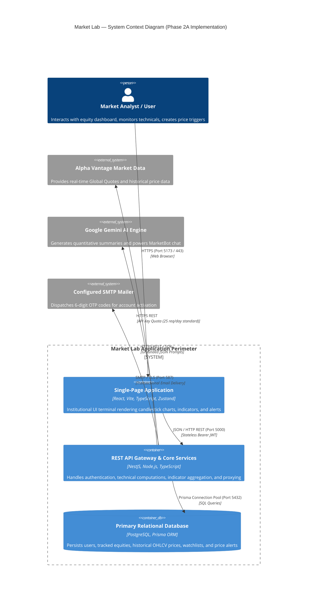
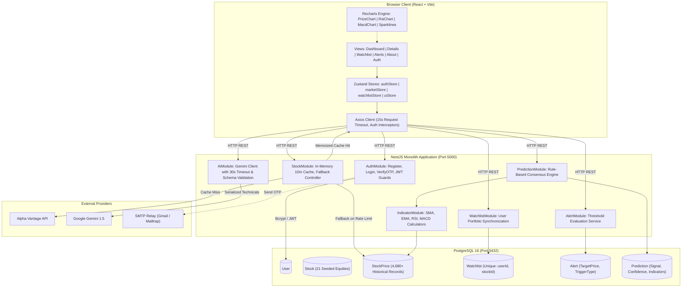
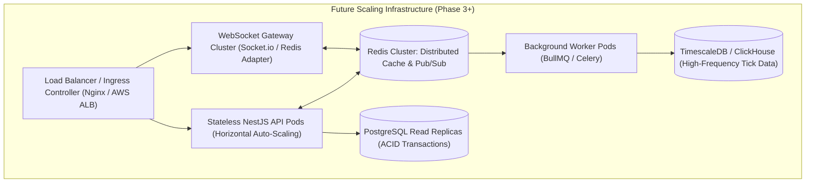

# Market Lab — System Design & Architecture Specification

## Phase 2A — Institutional Architecture & System Blueprint

This document details the concrete, actual system design of the **Market Lab (Smart Stock Analysis & Prediction Dashboard)** platform. It reflects the working source code rather than hypothetical microservices, and delineates current production realities from proposed future scaling milestones.

---

## 1. System Overview & Architectural Paradigm

Market Lab operates as a **modular monolithic architecture** designed for high cohesion, low operational complexity, and strict transactional consistency. 

### Core Tech Stack:
- **Frontend Presentation Layer**: React 18, Vite 5, TypeScript 5, React Router 6, Zustand state stores, and Recharts 2.
- **Backend Application Layer**: NestJS 10 (Node.js runtime), TypeScript, Class-Validator, and Passport JWT.
- **Data Persistence Layer**: PostgreSQL 16 managed via Prisma ORM 5.
- **External Integrations**:
  - Alpha Vantage REST API (Global Quote & historical daily candles).
  - Google Gemini Generative AI (LLM synthesis & MarketBot chat).
  - Nodemailer SMTP (Email one-time password verification delivery).

---

## 2. Current Architecture — System Context & Data Flow

---

## 3. Detailed Component & Service Architecture

---

## 4. Subsystem Pipelines & Lifecycle Specifications

### A. Authentication & Session Lifecycle
1. **Registration**: Client sends `POST /auth/register` with `name`, `email`, `password`.
   - Backend checks if verified user exists (`400 Conflict`).
   - If user exists but is unverified, checks 30s rate-limiting map before updating password hash and issuing a new 6-digit OTP.
   - OTP is generated via crypto-safe RNG, expiring in 5 minutes (300 seconds).
   - Email is dispatched via Nodemailer.
2. **OTP Verification**: Client sends `POST /auth/verify-otp` with `email` and `otp`.
   - Attempt counter enforces a maximum of 5 attempts. Exceeding 5 attempts clears the OTP and requires fresh registration.
   - On success, `isVerified` is toggled to `true`, and OTP fields are nulled.
3. **Login & Lockout**: Client sends `POST /auth/login`.
   - Enforces a 5-minute lockout if 5 consecutive failed password attempts occur.
   - On valid credentials, a signed JWT (`HS256`, 7-day expiration) containing `{ sub: userId, email }` is issued.
   - No sensitive passwords, hashes, or OTPs are ever exposed in client responses.

### B. Market Data Ingestion & 3-Tier Fallback Strategy
1. **Tier 1 (In-Memory Cache)**: Quotes are cached in-memory with a 10-minute (600s) TTL keyed by symbol.
2. **Tier 2 (Live API)**: On cache miss, `StockService` requests `GLOBAL_QUOTE` from Alpha Vantage with automatic request throttling and API key rotation.
3. **Tier 3 (Database Fallback)**: If Alpha Vantage returns rate-limit notices (`Note: Thank you for using Alpha Vantage...` or HTTP 429), the service transparently queries the PostgreSQL `StockPrice` historical table, computes the latest closing price and percentage change, and tags the payload with `isFallback: true, source: 'cache'`. The UI explicitly displays this state with a data freshness badge.

### C. Technical Indicators & Prediction Engine
- **Moving Averages (SMA / EMA)**: Calculated over closing prices. Minimum 20 historical periods required for SMA(20) and EMA(20); minimum 50 periods for SMA(50).
- **RSI (14-period)**: Calculated using Wilder's smoothed average of gains and losses. Output bounded strictly between 0 and 100 with 30 (Oversold) and 70 (Overbought) benchmarks. If history has fewer than 15 points, `rsi` returns `null`.
- **MACD (12, 26, 9)**: 12-period EMA minus 26-period EMA produces the MACD line; 9-period EMA of the MACD line produces the Signal line; MACD minus Signal produces the Histogram. Requires at least 26 periods.
- **Rule-Based Prediction Consensus**:
  - `BUY`: RSI < 35 AND Price > SMA(20), or bullish MACD crossover (Hist > 0 and expanding).
  - `SELL`: RSI > 65 AND Price < SMA(20), or bearish MACD divergence (Hist < 0 and contracting).
  - `HOLD`: Conflicting or neutral momentum indicators.
  - **Confidence**: When technical history is insufficient (< 20 periods), confidence is reported as 0% (avoiding misleading 50% baseline).

### D. Price Alert Lifecycle
- **Creation**: Authenticated analyst establishes target price and `ABOVE` / `BELOW` condition (`POST /alerts`).
- **Evaluation Mechanism**: In Phase 2A, alerts are evaluated **on-demand** upon quote synchronization or dashboard load by comparing `alert.targetPrice` with `stock.price`.
- **Honest System Boundary**: The system currently does **NOT** run a 24/7 background worker or push notifications. Triggered states (`Trigger Met`) are surfaced in the active user session.

### E. AI Analysis & MarketBot Pipeline
- **Context Grounding**: Prior to calling Google Gemini, the application computes deterministic indicators (Price, SMA, EMA, RSI, Volume) and passes them as structured context.
- **Client Resilience**: Axios clients enforce a strict 30-second timeout on AI endpoints to prevent hanging UI threads.
- **Sanitization & Guardrails**: Gemini responses are validated before returning to the UI. The UI surfaces a prominent financial disclaimer stating that LLM output is educational synthesis, not financial advice.

---

## 5. Security & Boundary Architecture

| Boundary | Control Mechanism | Failure Mode Handling |
| :--- | :--- | :--- |
| **Client -> API** | CORS whitelist, NestJS `ValidationPipe(whitelist: true)` | Strips unknown properties, rejects malformed payloads (HTTP 400) |
| **API -> Route Guards** | `AuthGuard('jwt')` checking `Authorization: Bearer <token>` | HTTP 401 Unauthorized redirecting client to `/auth` |
| **Rate Limiting** | OTP generation map (30s cooldown), Login failed map (5 attempts) | HTTP 400 / 429 with remaining retry cooldown in seconds |
| **Database Access** | Prisma parameterized queries (100% SQL injection immune) | Database errors logged server-side, generic 500 returned to client |
| **External API Keys** | Injected via environment variables, untracked from Git | Graceful fallback to seeded database records |

---

## 6. Future Scaling Architecture (Phase 3+ Blueprint)

The following architecture represents a planned future roadmap for high-frequency trading volumes and enterprise scale. **None of these components are deployed or introduced as dependencies in Phase 2A.**

### Architectural Justification: Why Single PostgreSQL is Right for Now
1. **Measured Workload**: With 21 tracked equities and standard 90–365 daily OHLCV bars (~4,700 records), the entire dataset easily fits into RAM (< 5 MB). Standard PostgreSQL B-Tree indexes yield query latencies < 2 milliseconds.
2. **Operational Overhead**: Adding Redis, BullMQ workers, Kafka, or TimescaleDB at this stage would introduce distributed state synchronization bugs, increased deployment costs, and operational fragility with zero user-perceptible latency benefit.
3. **Threshold for Additional Infrastructure**:
   - Introduce **Redis Cache**: When concurrent active users exceed 1,000 or external API rate limits must be shared across multiple stateless container replicas.
   - Introduce **BullMQ Workers**: When 24/7 background alert push notifications (SMS/Email) are activated for thousands of dormant users.
   - Introduce **TimescaleDB / ClickHouse**: When ingesting sub-second level-2 order book tick data exceeding 5,000,000 rows/day.
   - Introduce **WebSockets**: When real-time live trading desk streaming is required instead of 10-minute memoized REST polling.
